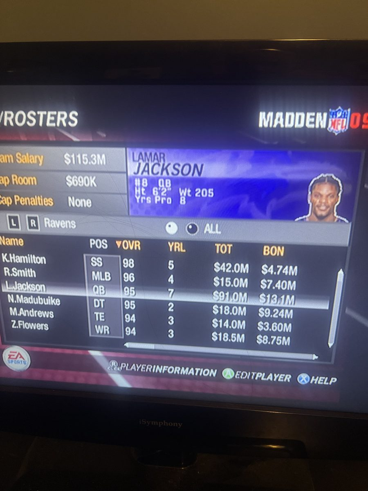
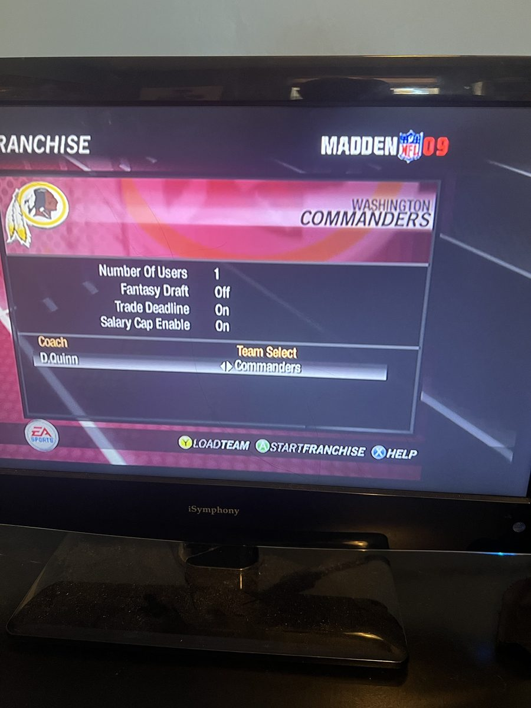
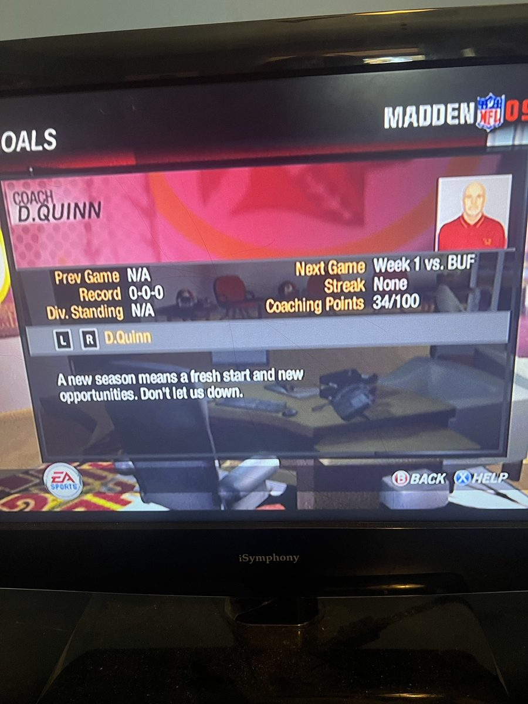
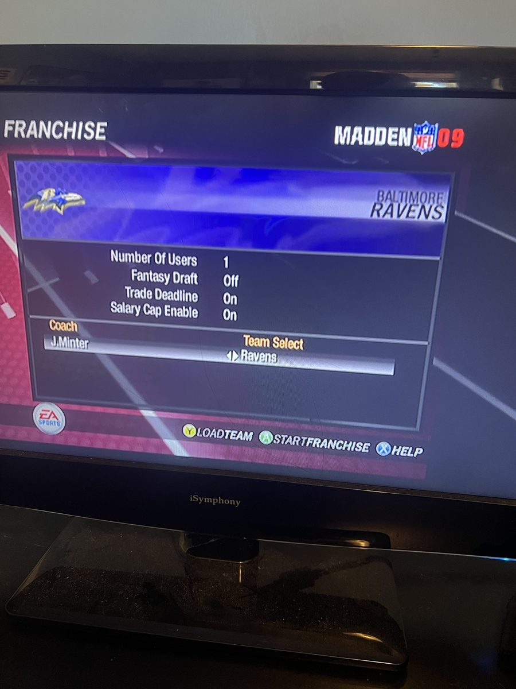
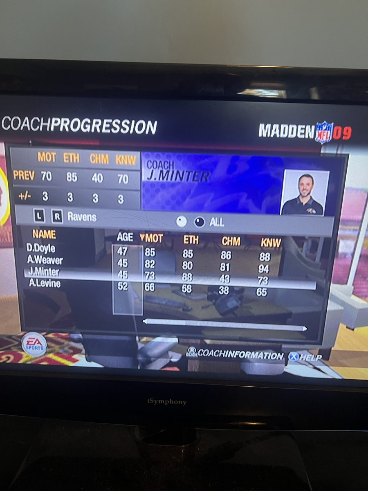

# Madden NFL Xbox fixes and mods (2005–09)

Fixes and mods for the original-Xbox Madden NFL games, built by reverse-engineering the games' own code and databases. The main target is **Madden NFL 09**. The aim is a franchise mode you can play for many seasons, plus modern rosters, more music, and your own screens.

| Feature | Games | Status |
|---|---|---|
| **Awareness-inflation fix**: role bonuses leaked into ratings every season | 07, 08, 09 | 09 tested on hardware over several franchise seasons; 07/08 checked by disassembly only |
| **Modern rosters** from EA's ratings site (Madden 27 tested), with current headshots and matched skin tones | 09 | Working on hardware |
| **2026 coaching staffs**: all four coaches per team with current team photos, real ages and NFL head-coaching records; modern team names (Commanders, Las Vegas Raiders, LA Chargers and Rams) while the classic teams keep theirs | 09 | Working on hardware |
| **Soundtracks from 2005–08** (107 songs) added as four extra EA Trax soundtracks | 09 | Working on hardware |
| **Progression tuning**: 2005's in-season progression, or a "performance" mode where good seasons develop players, bad ones cost them, and 99s stay rare | 09 | Working on hardware; `performance` is the default (results in [docs/findings.md](docs/findings.md)) |
| **Custom loading and start screens** | 09 | Working on hardware (bring your own image) |
| **Dashboard rename** so the modded copy sits next to the stock game | 07–09 | Working on hardware |
| **Attract-mode demo off** (leaving it hard-locks the console, even on the stock game) | 09 | Timer confirmed on hardware |

There's nothing here for Madden 06 yet: it has no role system, so the awareness bug can't happen there.

## Screenshots

Taken on a real (softmodded) Xbox, straight off the TV.

<table>
<tr>
<td></td>
<td></td>
<td></td>
</tr>
<tr>
<td>The Madden 27 roster with EA's current headshots, ratings and contracts</td>
<td>Modern team names on 09's teams (the logo art is still 2008's)</td>
<td>The 2026 head coaches, with their team-site photos</td>
</tr>
<tr>
<td></td>
<td></td>
<td></td>
</tr>
<tr>
<td>Jesse Minter, the Ravens' new head coach</td>
<td>The whole 2026 Ravens staff: Minter, coordinators Doyle, Weaver and Levine</td>
<td></td>
</tr>
</table>

## What's in the repository, and what isn't

This repository contains **only scripts and documentation** (plus the screenshots above). It contains no game files, no patched game files, no saves, and no EA ratings data or photos. You need your own copies of the games (an extracted disc folder for each), and you download the roster data yourself with the included scripts. Everything the scripts produce is a patched copy of *your* files.

Modified XBEs can't be re-signed, so you need a softmodded or modchipped Xbox (or an emulator such as xemu).

## Quick start

```
pip install -r requirements.txt

# optional: modern roster data
python roster/fetch_ea_ratings.py roster/madden27.json
python roster/fetch_headshots.py roster/madden27.json roster/headshots_raw
python roster/fetch_coach_photos.py roster/coach_photos       # 2026 coaching staffs' photos

# build the overlay (only changed files)
python tools/build_all.py --games "<folder with the extracted games>" --out build/09 \
    --roster roster/madden27.json --photos roster/headshots_raw --coach-photos roster/coach_photos \
    --loadscreen my_loading.png --startscreen my_start.png
```

`--games` must contain `Madden NFL 09 (USA)`, plus `Madden NFL 2005 (USA)`, `Madden NFL 06 (USA)`, `Madden NFL 07 (USA)` and `Madden NFL 08 (USA)` for the music and for 2005 progression. Run `python tools/build_all.py -h` for all options, including `--progression` and `--no-music`.

**Install:** on the Xbox, copy the whole game folder to a new folder (for example `E:\Games\Madden NFL 09 Modded\`). Then copy the overlay over it, replacing files. Keep the stock folder untouched. The renamed XBE shows up as "Madden NFL 09 Modded" and shares saves with the original. Read [docs/workflow.md](docs/workflow.md) before installing: it covers the memory-card roster that overrides the default roster, file sets that must match, and how to test changes.

## Repository layout

| Path | Contents |
|---|---|
| [`patches/`](patches/README.md) | XBE patches (awareness fix, rename), music import, progression tables, `fe.qkl` sync |
| [`patches/loadscreen/`](patches/loadscreen/README.md) | Loading and start screen packers, TERF/MMAP/LZH1 helpers |
| [`roster/`](roster/README.md) | EA ratings and headshot fetchers, the roster builder, 2026 coaching staffs (`coaches.py`, photo and record fetchers), TDB database library |
| [`tools/`](tools/) | `build_all.py` (one-command build), `franchise_report.py` (compare franchise saves), `xdis.py` (XBE disassembly helper) |
| [`docs/`](docs/) | [workflow](docs/workflow.md), [file formats](docs/formats.md), [research findings](docs/findings.md), [roadmap and open tests](docs/roadmap.md) |
| [`CLAUDE.md`](CLAUDE.md) | Orientation for AI coding agents working on this project |

## Credits and legal

Madden NFL is a trademark of Electronic Arts. This is an unofficial fan project and isn't affiliated with or endorsed by EA or the NFL. No EA code or data is distributed here. The scripts read and patch files from games you own, and fetch public ratings data from EA's website and coach photos from the teams' websites for personal use. The screenshots show the game running and are included only to illustrate the mods.
