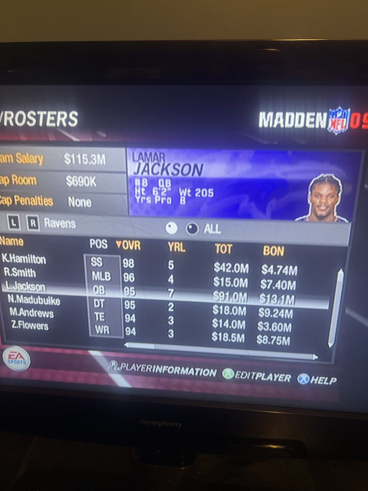
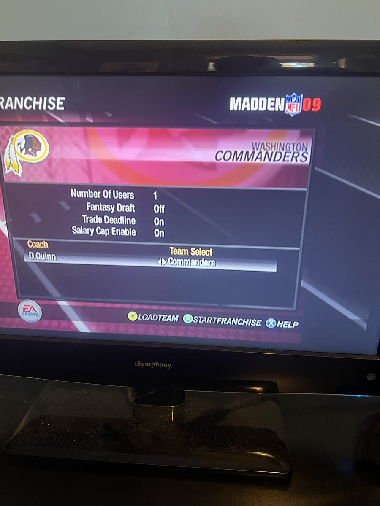
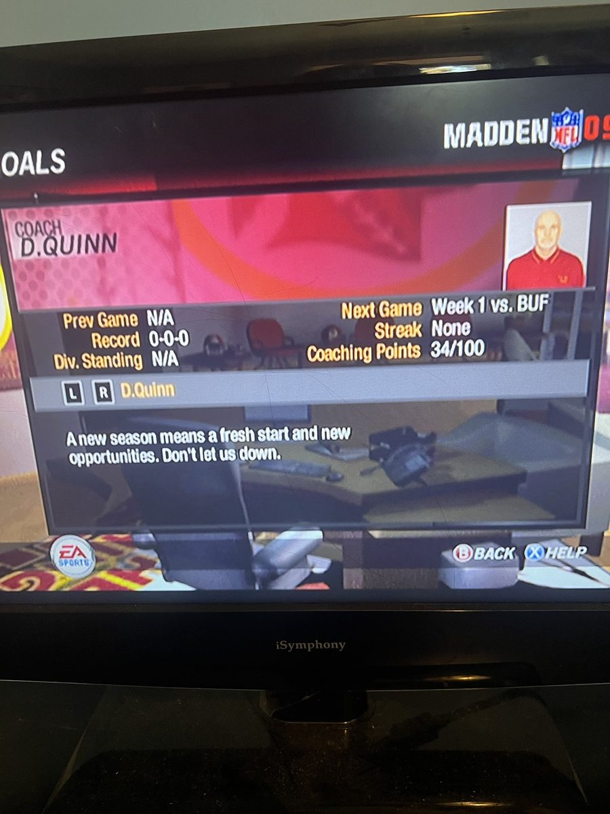
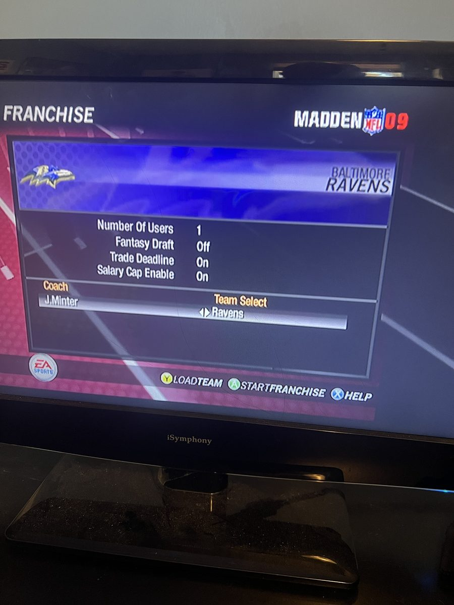
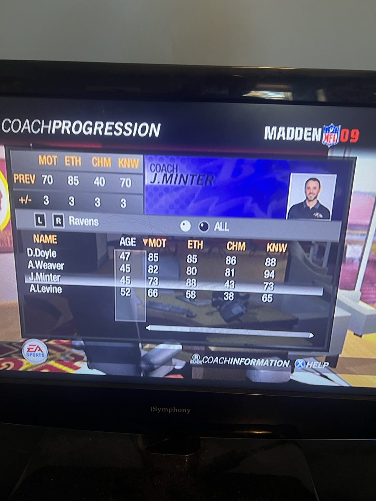

# Madden NFL Xbox fixes and mods (2005–09)

Fixes and mods for the original-Xbox Madden NFL games, built by reverse-engineering the games' own code and databases. The main target is **Madden NFL 09**. The aim is a franchise mode you can play for many seasons, with a 17-game season, modern rosters, more music, and your own screens.

> **Just want to play?** [Download the ZIP](https://github.com/Parlett316/Original-Xbox-Madden-Project/archive/refs/heads/main.zip), unzip it, and double-click **Install Madden 09 Mods.bat**. It asks where your Madden is (your PC or your Xbox), which mods you want, and puts a modded copy next to your original. It runs on an Xbox, in xemu, and on a modded **Xbox 360** too. See [Easy install](#easy-install-start-here).

**Release v1.0** (2026-11-20): one `build_all.py` command builds everything below that's on the author's Xbox, byte for byte. The command and the install list are in [docs/release.md](docs/release.md).

| Feature | Games | Status |
|---|---|---|
| **Awareness-inflation fix**: role bonuses leaked into ratings every season | 07, 08, 09 | 09 tested on hardware over several franchise seasons; 07/08 checked by disassembly only |
| **17-game, 18-week season** with a 3-week preseason, on by default; `--schedule` makes year 1 a real NFL season (2026 tested) | 09 | Working on hardware through year 4 |
| **Modern rosters** from EA's ratings site (Madden 27 tested), with current headshots, matched skin tones, and overalls from the game's own formula | 09 | Working on hardware |
| **97 extra free agents** so positions don't run out; opt-in with `--free-agents` | 09 | Franchise reaches year 2 on hardware |
| **7-team playoffs** per conference with one bye; on by default with the 17-game season (`--no-playoffs7` opts out). A franchise created before keeps 6 teams for the season it's in | 09 | Simmed through two seasons on hardware; a playoff game hasn't been played by hand. The bracket works on hardware. Older franchises are tested in xemu only: 6 teams for the season in progress, 7 from the next |
| **Optional fullback**: a team can carry none, and a tight end fills in; opt-in with `--optional-fullback` | 09 | Played a game and simmed a season and offseason on hardware |
| **2026 coaching staffs**: all four coaches per team with current team photos, real ages, NFL head-coaching records, ratings by rank and real coaching histories since 1999 (with every team's real 1999–2025 records); modern team names (Commanders, Las Vegas Raiders, LA Chargers and Rams) while the classic teams keep theirs | 09 | Working on hardware |
| **Soundtracks from 2005–08** (107 songs) added as four extra EA Trax soundtracks | 09 | Working on hardware |
| **Progression tuning**: 2005's in-season progression, or a "performance" mode where good seasons develop players, bad ones cost them, and 99s stay rare | 09 | Working on hardware; `performance` is the default (results in [docs/findings.md](docs/findings.md)) |
| **Edited franchise saves**: load a save changed on a PC; opt-in with `--save-unlock` | 09 | Load, save and reload tested on hardware with a jersey edit only |
| **Al Michaels says "Washington"** for the Commanders instead of "the home team"; classic Redskins teams keep "Redskins". Opt-in with `--commanders-commentary` | 09 | Working on hardware |
| **Modern kickoff**: ball on the 35, the NFL's hybrid lineup with everyone held until the receiving team touches the ball, touchbacks to the 35, and a kick out of bounds to the receiving 40. Opt-in with `--modern-kickoff` | 09 | Working on hardware; a kick landing short of the 20 still follows the stock rule |
| **Any jersey number** (0-99) at any position in the edit screen; rookies and signings keep traditional numbers. Opt-in with `--any-number` | 09 | Working on hardware |
| **The Tony Bruno radio show** from Madden 07 in the franchise menus: a show each week built from the franchise's own storylines, then the music returns. Off by default (`build_all.py --radio-show`); needs a Madden 07 disc's files | 09 | Working on hardware |
| **Online play without Xbox Live**: Madden 09's own online menus, lobby, invites and head-to-head games, through a small lobby server you run yourself. Off by default (`build_all.py --online <server IP>`) | 09 | A full game played between a real Xbox and xemu, in sync; a work in progress |
| **The Commanders' W** in menus and on the white, burgundy and training camp helmets; classic Redskins teams keep their logo. Opt-in with `--commanders-logo` and your own image | 09 | Working on hardware; the alternate uniforms keep the old helmet |
| **Custom loading and start screens** (the start screen shows only the middle of its image, and overlays sit in the top corners) | 09 | Working on hardware (bring your own image) |
| **Dashboard rename** so the modded copy sits next to the stock game | 07–09 | Working on hardware |
| **Attract-mode demo off** (leaving it hard-locks the console, even on the stock game) | 09 | Timer confirmed on hardware |
| **Runs on an Xbox 360** (a modded 360's backward compatibility). Opt-in with `--xbox360`, or tick "Also runs on an Xbox 360" in the installer | 09 | The full v1.0 build boots on a hacked 360 and simmed a franchise into the offseason |

There's nothing here for Madden 06 yet: it has no role system, so the awareness bug can't happen there.

## Easy install (start here)

1. [Download the ZIP](https://github.com/Parlett316/Original-Xbox-Madden-Project/archive/refs/heads/main.zip) and unzip it anywhere.
2. Double-click **Install Madden 09 Mods.bat**. The first time it offers to install Python and then the packages the mods need.
3. Then it's four steps:
   1. **Where is your Madden?** A folder on your PC (it looks for one, or press Browse and pick something like `C:\Madden09`), or your Xbox's hard drive (type the IP address your dashboard shows; the FTP user and password are usually `xbox`). Madden 2005 to 08 are optional and unlock more music, the radio show and realistic progression.
   2. **What mods do you want?** Tick boxes in plain words, with the recommended ones ticked.
   3. **Mod it.** Choose where the modded game goes, a new folder on the Xbox or on your PC, and press **Mod my game!** It downloads today's rosters, builds, and copies the whole modded game there, checking every file.
   4. **Profit!** It says what to do next, and can move old roster saves out of the way.

Your original game folder is never changed. Running it again later only copies what changed.

You need a softmodded or modchipped Xbox, a modded Xbox 360, or xemu, and your own copy of Madden NFL 09 as a game folder. The rest of this page is for people who want to know how it works or build from the command line.

### What the installer does for you

Modding this game by hand means running a dozen scripts in the right order, keeping files that belong together in step, and copying gigabytes over FTP without a single file coming over short. The installer does all of that:

- **It finds your games.** It searches your PC's drives, Desktop, Downloads and Documents, or your Xbox's hard drive, and tells each Madden apart by what's inside it, not what the folder is called.
- **It won't touch your original, or a modded copy you made yourself.** It checks your Madden 09 is the untouched original and always makes a new folder. If a folder you pick already holds a game it didn't make, it refuses.
- **It speaks your Xbox's language.** The Xbox dashboards' file servers have quirks, such as listing the wrong folder or allowing only a couple of connections at once. The installer was tested against a real UnleashX Xbox and works around them.
- **It gets today's NFL for you.** It downloads the current ratings and player photos from EA, the coaching staffs' photos, and real stats and the 2026 schedule from nflverse. If a website drops the connection, it waits and tries again.
- **It builds only what you ticked.** If you pick the radio show, it copies just Madden 07 from the Xbox, not every older Madden.
- **It checks every file it copies,** sends again any file that came over short, and keeps a list of what it put there. Next time it copies only what changed, and removes leftovers from an older build.
- **It finds old roster saves** that would make the game load an old roster instead of the new one. It backs them up to your PC before removing them, and only if you say yes.
- **You can stop it at any time.** Press Mod my game! again later and it picks up where it left off.

### If something goes wrong

- **"Too many FTP connections"**: the Xbox only allows a couple at once. Close FileZilla or any other FTP program, wait a minute, and press the button again.
- **It's slow the first time**: downloading the rosters and copying about 2 GB takes 15 to 45 minutes. After that, only what changed is copied.
- **About 150 players have no photo**: EA has none for them (mostly rookies), so they get the game's generic face.
- **Anything else**: the box under the progress bar shows what happened. Copy its last lines into a GitHub issue.

## Playing on an Xbox 360

A modded Xbox 360 can play original-Xbox games through its backward compatibility, and stock Madden 09 is one of the games it runs. The modded game runs too, with one tick:

1. In the installer's mod list, tick **Also runs on an Xbox 360** (under Extras). From the command line it's `build_all.py --xbox360`.
2. Let it build to a folder on your PC, then copy the whole folder (`default.xbe` and `data`) to your 360 and launch `default.xbe` from your dashboard the way you launch other original-Xbox games.

The same build still works in xemu.

**Why it needed a fix.** The first try on a 360 stopped at "encountered an error". Sixteen test versions of the game's main file, each changing one thing, narrowed it down: the 360 doesn't mind a modified game, but it refuses to run code from the very start of the file (its header), where several mods kept their extra code. A real Xbox and xemu allow it, so it had never come up. The fix moves that code to the end of the file instead, unchanged, and redirects the jumps into it. With it, the whole build boots on a 360 and a franchise simmed through a season and the playoffs into the offseason with everything working. The details are in [docs/findings.md](docs/findings.md#15-running-on-an-xbox-360-09).

Not tried yet: online play from a 360, and the moved version on an original Xbox (until then, leave the tick off for an Xbox).

## The Tony Bruno Show is back

Madden 2005, 06 and 07 had EA SPORTS Radio in franchise mode: Tony Bruno talking about last week's games, taking calls, interviewing coaches and running trivia. Madden 08 and 09 dropped it. It now plays in Madden 09's franchise menus again, on a real Xbox, with today's rosters. In one test franchise he reported that Rhamondre Stevenson of the Patriots was unhappy about his playing time.

Each week you get one show when you reach the franchise menu: an intro, a few segments, a sign-off, and then the menu music comes back. Nothing plays on the load screens, in a fantasy draft or while weeks are simulating.

### How it was found

The roadmap had this down as unrealistic: the show is game code plus audio, and 09 has neither. Then the pieces turned up one at a time.

1. **08 only switched it off.** Madden 08 ships Madden 07's 228 MB radio audio file byte for byte, but its loader skips the show's part. Madden 09 cut the file down to 2.3 MB of draft announcements. So 07 was the last game that played it, and the closest to 09.
2. **09 can still play the audio.** The show's clips are in the same format as the play-by-play commentary, and 09 kept the whole speech engine. With 07's file loaded and one event fired by hand, 09 picked the clips but stayed silent: its menus only turn the speech volume up for the draft's "on the clock" line. With that check removed, Tony asked a caller how heavy a football is.
3. **09 never stopped writing the show.** Its story engine still adds a row to the franchise save whenever something newsworthy happens, for a radio show nobody plays. Madden 07's code turned those rows into a week's show. That code is gone from 09.
4. **07's show code moves across.** It is one block of about 10 KB that calls eight functions in the rest of the game. Seven of them are still in 09, byte for byte apart from addresses, and the eighth is 54 bytes. `patches/radio_transplant.py` copies the block out of a Madden 07 XBE and fixes every call, jump table, string and variable so it runs inside 09's. It stops if it finds an address it can't account for.
5. **The rest is new.** 07 started the show from a radio screen that 09 doesn't have, so a small hook decides when it plays. Getting that right took several rounds on the console: Tony talking over the load screen, a show that played twice, a new show for every week of a season sim, and players called by the wrong name ("Mike Brown" for Chase Brown, because the old commentary IDs point at 2006 players). He now uses surnames only.

The full notes, with addresses, are in [docs/findings.md §12](docs/findings.md#12-the-radio-show-2005-to-07).

### Trying it

Add `--radio-show` to the `build_all.py` command. It needs your own copy of Madden 07 as well as 09, in the games folder as `Madden NFL 07 (USA)`. The build's `default.xbe` is 16,384 bytes larger than without it, and Madden 07's `SPCHFEDT.dat` is added to the `data` folder as `spchfe07.dat` (228,714,976 bytes). The stock speech file stays where it is. Leave the option out for a build without the show.

What it doesn't have yet: a way to turn the show off in the game, and 07's radio screen for skipping or replaying a segment. A player whose surname EA never recorded gets no story.

## Online play is back, without Xbox Live

Xbox Live for the original Xbox shut down in 2010, and Insignia, the community service that revived many Live games, doesn't support Madden 09. The game's online mode had been dead ever since. It works again now: two consoles log in to a lobby, meet in a room, one invites the other, both pick their teams in Game Setup, and they play a full game against each other. The first one was a real Xbox, with its owner on the sticks for the Commanders, against an emulated Xbox in xemu, and both screens stayed in step from the coin toss to the end.

Nothing of EA's is needed. The lobby is a small Python program, `tools/aries_server.py`, that runs on a PC or a home server, and the game is patched to talk to it instead of Xbox Live.

### How it was done

This looked far-fetched: the game's online code is built on Xbox Live from the ground up, and EA's servers are long gone. It came together one wall at a time.

1. **Getting past Xbox Live.** EA's network code still had a hidden "system link" mode that skips the Live sign-in. With it switched on, the game goes straight to EA's servers, then gets stopped by the Xbox's network security, which drops any connection that isn't encrypted the Live way. Three small patches open the doors it needs for a plain connection to a PC.
2. **Rebuilding EA's lobby server.** The game speaks EA's "Aries" lobby protocol, the same family as EA's PS2 online games. The community project [breakin-in](https://github.com/riperiperi/breakin-in), a server for The Sims: Bustin' Out, documented part of it. The rest came from reading what Madden's own code expects in every reply. Some replies had to be exact or the menus hung silently, such as the rankings list the online menu waits for before it opens.
3. **Fixing what broke without Live.** Each time, the game froze with the console halted. Voice chat, game invites and the controller setup all asked Live for something that isn't there. Each one was traced in the xemu emulator and patched to carry on without it. The roster check that would have downloaded EA's 2008 roster over the modern one is switched off too.
4. **Connecting the two consoles.** The game looked up its opponent through Live's matchmaking, which fails straight away. It now uses the address the lobby already knows, and the two consoles talk directly to each other.
5. **The crashes during loading and play.** Loading the online game wrote one byte into the wrong place in memory, because the controller number was never set (only the Live sign-in screen sets it). Then the game's lag detector, built for two real consoles, kept ending matches against the slower emulator. Both are fixed. Player names, which came from Live gamertags, now come from a name stored in the game itself.

The full notes, with every address and packet, are in [docs/findings.md §14](docs/findings.md#14-online-play-without-xbox-live-09).

### Trying it

Run the lobby server on a PC or server that both consoles can reach, then build with its address and a name for each console:

    python tools/aries_server.py lobby.log --host 192.168.1.4
    python tools/build_all.py ... --online 192.168.1.4 --online-name YourName

Both consoles need the same build (the games run in lockstep). Offline play is unchanged. Still open: a lockup when your opponent disconnects, only a controller in port 1 works, a room one player creates doesn't show on the other's Lobby screen, and play over the internet hasn't been tried, only on a home network.

## Screenshots

Taken on a real (softmodded) Xbox, straight off the TV.

<table>
<tr>
<td></td>
<td></td>
<td></td>
</tr>
<tr>
<td>The Madden 27 roster with EA's current headshots, ratings and contracts</td>
<td>Modern team names on 09's teams (this shot predates the W logo)</td>
<td>The 2026 head coaches, with their team-site photos</td>
</tr>
<tr>
<td></td>
<td></td>
<td></td>
</tr>
<tr>
<td>Jesse Minter, the Ravens' new head coach</td>
<td>The whole 2026 Ravens staff: Minter, coordinators Doyle, Weaver and Levine</td>
<td></td>
</tr>
</table>

## What's in the repository, and what isn't

This repository contains **only scripts and documentation** (plus the screenshots above). It contains no game files, no patched game files, no saves, and no EA ratings data or photos. You need your own copies of the games (an extracted disc folder for each), and you download the roster data yourself with the included scripts. Everything the scripts produce is a patched copy of *your* files.

Modified XBEs can't be re-signed, so you need a softmodded or modchipped Xbox (or an emulator such as xemu).

## Building from the command line

```
pip install -r requirements.txt

# optional: modern roster data
python roster/fetch_ea_ratings.py roster/madden27.json
python roster/fetch_headshots.py roster/madden27.json roster/headshots_raw
python roster/fetch_coach_photos.py roster/coach_photos       # 2026 coaching staffs' photos

# build the overlay (only changed files)
python tools/build_all.py --games "<folder with the extracted games>" --out build/09 \
    --roster roster/madden27.json --photos roster/headshots_raw --coach-photos roster/coach_photos \
    --loadscreen my_loading.png --startscreen my_start.png
```

`--games` must contain `Madden NFL 09 (USA)`, plus `Madden NFL 2005 (USA)`, `Madden NFL 06 (USA)`, `Madden NFL 07 (USA)` and `Madden NFL 08 (USA)` for the music and for 2005 progression. Run `python tools/build_all.py -h` for all options, including `--progression`, `--no-music`, `--no-season17` (keep the stock 16-game season), `--schedule` (real NFL schedule for year 1), `--save-unlock` (load edited saves), `--free-agents` (extra free agents, with `--roster`), `--playoffs7` (7-team playoffs), `--commanders-commentary` (Al Michaels says "Washington") `--optional-fullback` (a team can carry no fullback) and `--modern-kickoff` (ball on the 35, hybrid lineup and hold, modern touchback and out-of-bounds spots). `--commanders-logo` takes your own W image for Washington's menu logo and helmets.

**Install:** on the Xbox, copy the whole game folder to a new folder (for example `E:\Games\Madden NFL 09 Modded\`). Then copy the overlay over it, replacing files. Keep the stock folder untouched. The renamed XBE shows up as "Madden NFL 09 Modded" and shares saves with the original. A franchise needs the build it was started on, because the season format differs (17 or 16 games). Read [docs/workflow.md](docs/workflow.md) before installing: it covers the memory-card roster that overrides the default roster, file sets that must match, and how to test changes.

## Repository layout

| Path | Contents |
|---|---|
| [`patches/`](patches/README.md) | XBE patches (awareness fix, rename, 17-game season, save unlock, 7-team playoffs, optional fullback), music import, progression tables, `fe.qkl` sync |
| [`patches/loadscreen/`](patches/loadscreen/README.md) | Loading and start screen packers, TERF/MMAP/LZH1 helpers |
| [`roster/`](roster/README.md) | EA ratings and headshot fetchers, the roster builder, 2026 coaching staffs (`coaches.py`, photo and record fetchers), TDB database library |
| [`tools/`](tools/) | `build_all.py` (one-command build), `franchise_report.py` and `save_diff.py` (compare franchise saves), `save_jump.py` (jump a franchise to a later week), `xdis.py` (XBE disassembly helper), `make_xiso.py` and `xbox_hdd.py` (disc image and save access for testing in xemu) |
| [`docs/`](docs/) | [workflow](docs/workflow.md), [file formats](docs/formats.md), [research findings](docs/findings.md), [roadmap and open tests](docs/roadmap.md) |
| [`CLAUDE.md`](CLAUDE.md) | Orientation for AI coding agents working on this project |

## Credits and legal

Madden NFL is a trademark of Electronic Arts. This is an unofficial fan project and isn't affiliated with or endorsed by EA or the NFL. No EA code or data is distributed here. The scripts read and patch files from games you own, and fetch public ratings data from EA's website and coach photos from the teams' websites for personal use. The screenshots show the game running and are included only to illustrate the mods.
